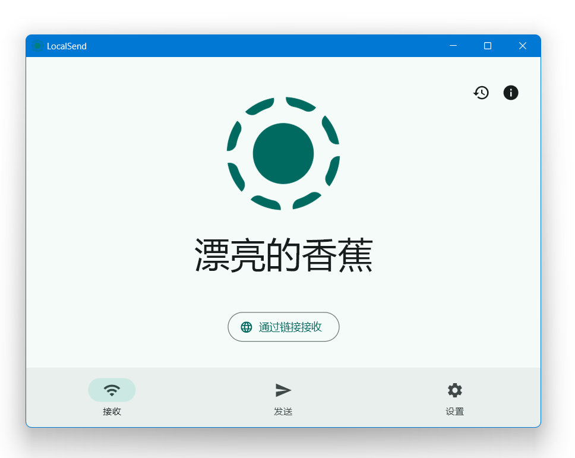

# LocalSend 快速启动

> 一键启动开源局域网传输工具 LocalSend：免联网、跨平台的 AirDrop 替代方案，支持快捷键和右键桌面快速唤起，手机与电脑互传文件。

---

## 核心特性

- **一键唤起**：全局快捷键或桌面右键即可启动 LocalSend，无需翻找开始菜单
- **免联网直传**：文件在同一局域网内设备间直接传输，不经过任何服务器
- **跨平台互传**：Windows、macOS、Linux、Android、iPhone/iPad 之间任意收发
- **端到端加密**：传输全程 TLS 加密，隐私安全
- **静默启动**：后台拉起 LocalSend，不闪命令行窗口
- **依赖开源软件**：基于 [LocalSend](https://localsend.org)（开源免费），本脚本仅负责快速启动

---

## 脚本演示

---

## 安装方法

本脚本的触发方式（快捷键、右键菜单）依赖"不忙脚本盒子"，建议仅通过盒子安装和使用本脚本。

> 前置条件：安装好 [不忙脚本盒子](https://www.bm-box.cn)，并在电脑上安装 [LocalSend](https://localsend.org)

* 打开盒子 → **脚本市场** → 搜索 **「LocalSend」**
* 点击「安装」

---

## 使用方式

* 直接启动
  * 在盒子里点击脚本卡片，LocalSend 随即打开
* 右键启动
  * 在桌面空白处右键 → 选择 **LocalSend**
* 快捷键启动
  * 为脚本设置全局快捷键（如 `Ctrl+Alt+L`），随时按下即唤起 LocalSend
  * 打开 LocalSend 后，在附近设备上即可收发文件

---

## 💡 使用提示

- 收发手机文件前，请确保手机与电脑连接**同一 Wi-Fi**，并在两台设备上都安装 LocalSend
- 若启动后没有反应，请先确认已单独安装 LocalSend 本程序，或电脑此前已通过命令 `localsend` 能正常启动
- 想开机即用：设置好快捷键后无需常驻后台，按一下即开、传完即关

---

## 🖥️ 环境要求

| 项目 | 要求 |
| --- | --- |
| **操作系统** | Windows 10+（64 位） |
| **运行环境** | 命令 `localsend` 可用（已安装 LocalSend 桌面版） |
| **依赖软件** | [LocalSend](https://localsend.org)（开源免费） |
